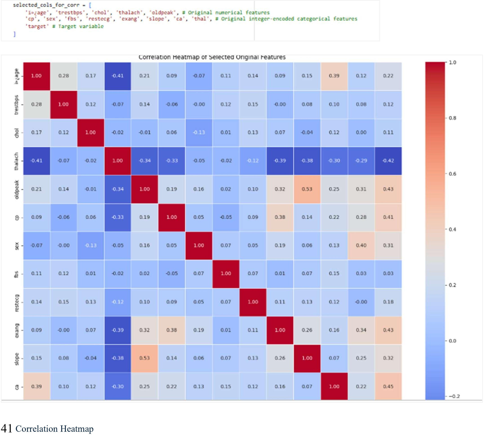
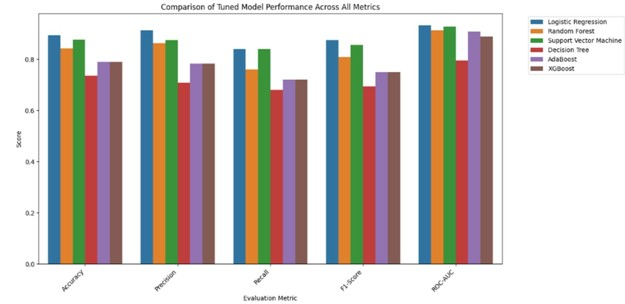
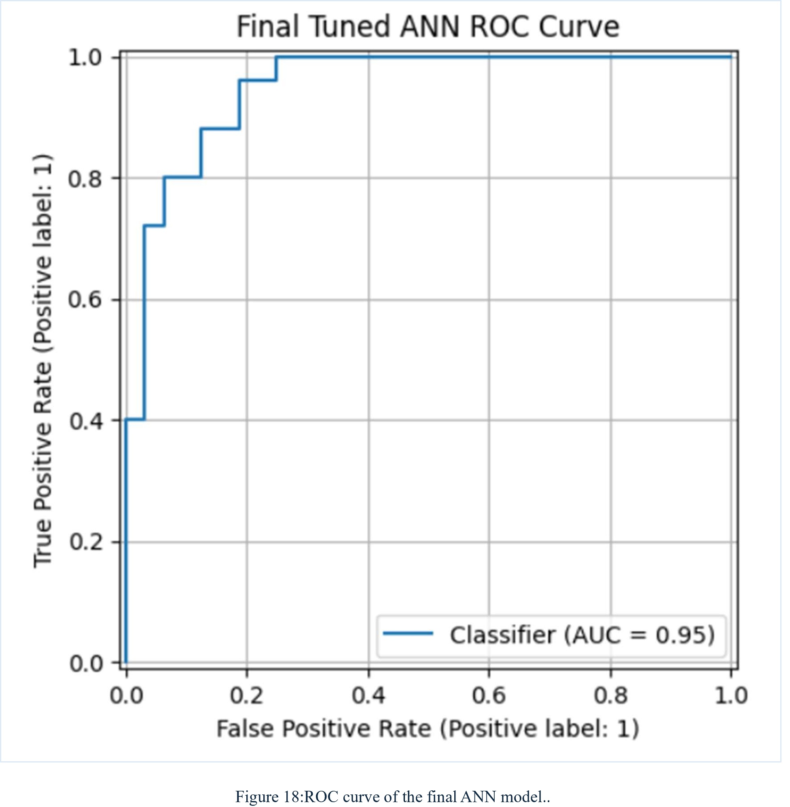
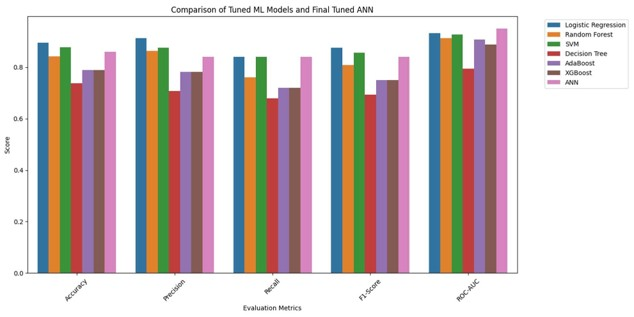

# Heart Disease Prediction Using Machine Learning & ANN

## Project Overview

This project investigates heart disease classification using **six conventional machine learning algorithms and an Artificial Neural Network (ANN)**.

The study combines data preprocessing, exploratory data analysis, statistical visualization, feature transformation, model training, hyperparameter optimization, cross-validation, and performance evaluation.

The conventional machine learning experiments formed part of collaborative academic coursework, while the individual research extends the investigation through ANN development, tuning, evaluation, interpretability, and model comparisons.

**Project Type:** Academic Artificial Intelligence & Machine Learning  
**Programming Language:** Python  
**Environment:** Google Colab / Jupyter Notebook  
**Machine Learning:** Scikit-learn, XGBoost  
**Deep Learning:** TensorFlow / Keras  
**Data Analysis:** Pandas, NumPy, Matplotlib, Seaborn  
**Status:** Completed academic experimentation and evaluation

> **Disclaimer:** This project is for academic research and demonstration. The models are not clinically validated and must not be used for medical diagnosis, treatment, or real-world clinical decision-making.

---

## 1. Problem Statement

Heart disease is a major healthcare concern, and the analysis of structured patient-related data can provide opportunities to explore predictive modelling techniques.

This project investigates how different machine learning approaches perform when classifying heart disease presence using a structured dataset containing clinical and demographic attributes.

The aim is to evaluate algorithms, compare their performance, identify potentially informative features, and explore whether an ANN can provide improvements over conventional classifiers.

The dataset and experimental evaluation are intended for educational purposes rather than clinical use.

---

## 2. Project Objectives

The main objectives were to:

- Perform data cleaning and preprocessing.
- Identify and handle missing values and duplicate records.
- Investigate outliers and data distributions.
- Apply categorical encoding and numerical scaling.
- Conduct univariate and bivariate exploratory data analysis.
- Analyse relationships between input variables and the target.
- Develop six conventional machine learning classifiers.
- Evaluate baseline model performance.
- Perform hyperparameter tuning.
- Apply cross-validation and examine overfitting.
- Build and tune an Artificial Neural Network.
- Compare conventional ML and ANN performance.
- Evaluate feature importance and model interpretability.
- Present findings using suitable metrics and visualizations.

---

## 3. Technologies and Libraries

| Technology | Purpose |
|---|---|
| Python | Data analysis and model development |
| Pandas | Dataset processing |
| NumPy | Numerical calculations |
| Scikit-learn | ML algorithms, preprocessing and evaluation |
| XGBoost | Gradient boosting classifier |
| TensorFlow / Keras | Artificial Neural Network development |
| Matplotlib | Performance and statistical visualizations |
| Seaborn | Exploratory visualizations |
| Google Colab | Notebook-based experimentation |

---

## 4. Dataset

The analysis uses a Cleveland-style heart disease classification dataset referenced in the notebook as:

`Heart_disease_cleveland_new.csv`

The dataset includes clinical and demographic predictor variables.

### Selected Variables

| Feature | Description |
|---|---|
| age | Patient age |
| sex | Encoded sex |
| cp | Chest pain category |
| trestbps | Resting blood pressure |
| chol | Cholesterol measurement |
| fbs | Fasting blood sugar indicator |
| restecg | Resting electrocardiographic results |
| thalach | Maximum heart rate |
| exang | Exercise-induced angina |
| oldpeak | ST depression measurement |
| slope | Exercise ST segment slope |
| ca | Number of major vessels |
| thal | Thalassemia-related categorical attribute |
| target | Binary heart disease classification label |

**Target variable:**
- `0` — Heart disease absent
- `1` — Heart disease present

The original CSV is not included in the uploaded project archive. To reproduce the notebook, obtain the matching dataset from an authorized source and verify its schema and preprocessing assumptions.

---

## 5. Data Preprocessing

The notebook includes a structured preprocessing workflow.

### Data Quality Checks

- Dataset shape and column inspection
- Data type validation
- Missing value analysis
- Duplicate detection and removal
- Descriptive statistics
- Outlier identification and handling

### Feature Preparation

- Categorical feature encoding
- Numerical feature standardization
- Predictor and target separation
- Training and testing data preparation

Preprocessing is an important part of the investigation because inconsistent values, unsuitable feature scales, and data quality issues can affect downstream model performance.

---

## 6. Exploratory Data Analysis

Exploratory analysis was performed to investigate variable distributions and relationships with the heart disease target.

### Univariate Analysis

The notebook explores demographic and clinical attributes, including age, cholesterol, blood pressure, heart rate, chest pain category, and other encoded predictors.

### Bivariate Analysis

The analysis examines relationships such as:

- Heart disease and sex
- Heart disease and chest pain
- Heart disease and fasting blood sugar
- Heart disease and exercise-induced angina
- Heart disease and electrocardiographic results

### Correlation Analysis

A correlation heatmap was developed to explore relationships between numerical variables.

The exploratory findings support understanding the data and informing subsequent modelling decisions.

---

## 7. Conventional Machine Learning Models

Six machine learning classification algorithms were implemented.

### Logistic Regression

An interpretable linear classification approach used as a baseline for binary heart disease classification.

### Random Forest Classifier

An ensemble approach combining multiple decision trees to model nonlinear relationships.

### Support Vector Machine

A margin-based classification method evaluated for separating the two target classes.

### Decision Tree Classifier

A tree-based classification approach that provides interpretable splitting rules.

### AdaBoost Classifier

A boosting ensemble that combines weak learners to improve classification performance.

### XGBoost Classifier

A gradient boosting algorithm evaluated for predictive classification.

Each algorithm was trained and evaluated using the experimental framework documented in the notebook.

---

## 8. Model Evaluation

The project uses multiple evaluation metrics rather than relying solely on accuracy.

### Evaluation Metrics

- Accuracy
- Precision
- Recall
- F1 Score
- ROC-AUC
- Confusion Matrix
- ROC Curve
- Cross-Validation Scores

These metrics help identify differences in classification performance and explore the trade-offs between detecting positive cases and avoiding false-positive predictions.

### Hyperparameter Tuning

The notebook includes tuning experiments using techniques such as:

- GridSearchCV
- RandomizedSearchCV
- Cross-validation
- Model-specific parameter optimisation

The results were compared with baseline model performance to assess the effects of tuning.

### Conventional ML Comparison

The analysis also considers signs of overfitting and underfitting when comparing training and evaluation results.

---

## 9. Artificial Neural Network

The individual component extends the study through an Artificial Neural Network developed using TensorFlow and Keras.

### ANN Development

The investigation includes:

1. Preparing training and validation data.
2. Designing a baseline neural network.
3. Training the baseline ANN.
4. Evaluating initial predictive performance.
5. Testing different hidden-layer architectures.
6. Fine-tuning the selected architecture.
7. Evaluating the final tuned ANN.
8. Visualizing training curves and predictions.
9. Comparing the tuned ANN against conventional ML models.

### ANN Architecture and Tuning

The notebook experiments with neural network components including:

- Dense layers
- Dropout
- Batch normalization
- Activation functions
- Adam optimization
- L2 regularization
- Early stopping
- Learning-rate adjustment

### ANN Evaluation

The individual academic report documents a final ANN ROC-AUC of approximately **0.95**.

This is a reported result from the experiment, not independent clinical validation or a guarantee of generalization to external patient populations.

---

## 10. Feature Importance and Interpretability

The project investigates feature importance to understand how different predictors contribute to classification performance.

Methods include:

- Tree-based feature importance
- Permutation importance for the ANN
- Feature-ranking comparisons across models
- Visual comparison of important predictors

These analyses provide an exploratory interpretation of model behaviour; they do not establish medical causality.

---

## 11. Final Model Comparison

The notebook combines conventional ML results and ANN results to compare:

- Accuracy
- Precision
- Recall
- F1 Score
- ROC-AUC

The comparison examines whether a more complex neural network offers meaningful improvements relative to conventional algorithms.

### Key Research Observations

- Model performance varies across algorithms and configurations.
- Hyperparameter tuning can change both predictive performance and generalization.
- ANN architecture and regularization choices affect training behaviour.
- Feature importance provides additional context beyond evaluation scores.
- High experimental ROC-AUC does not establish clinical reliability.

---

## 12. Project Structure

    Heart-Disease-Prediction-ML-and-ANN/
    ├── notebooks/
    │   └── Heart_Disease_ML_ANN.ipynb
    ├── docs/
    │   ├── Group_ML_Report.pdf
    │   └── Individual_ANN_Report.pdf
    ├── images/
    │   ├── correlation-heatmap.png
    │   ├── ml-model-comparison.png
    │   ├── ann-roc-curve.png
    │   └── final-model-comparison.png
    ├── data/
    │   └── .gitkeep
    ├── README.md
    └── .gitignore

---

## 13. How to Explore the Project

### Prerequisites

- Python
- Jupyter Notebook or Google Colab
- Pandas
- NumPy
- Scikit-learn
- Matplotlib
- Seaborn
- XGBoost
- TensorFlow / Keras

### Run the Notebook

1. Clone or download the repository.
2. Open `notebooks/Heart_Disease_ML_ANN.ipynb`.
3. Use Google Colab or a compatible Python environment.
4. Obtain the required `Heart_disease_cleveland_new.csv` dataset.
5. Make the CSV available at the location expected by the notebook.
6. Install any missing Python libraries.
7. Execute the notebook in order.

**Reproducibility note:** The notebook uses a Google Colab upload workflow and was originally developed in an academic environment. Dependencies, package versions, file paths, and the original dataset may need to be configured before reproducing the experiments.

---

## 14. Skills Demonstrated

### Data Science and Analytics

- Python Programming
- Data Cleaning
- Exploratory Data Analysis
- Statistical Visualization
- Feature Encoding and Scaling
- Outlier Analysis
- Correlation Analysis

### Machine Learning

- Binary Classification
- Logistic Regression
- Random Forest
- Support Vector Machines
- Decision Trees
- AdaBoost
- XGBoost
- Cross-Validation
- Hyperparameter Tuning
- Model Evaluation
- ROC and Confusion Matrix Analysis

### Deep Learning

- TensorFlow / Keras
- Artificial Neural Networks
- Neural Network Architecture Design
- Dropout and Regularization
- Early Stopping
- Learning Rate Adjustment
- ANN Hyperparameter Tuning
- Model Interpretability

### Research and Documentation

- Collaborative Research
- Independent Experimentation
- Comparative Analysis
- Critical Evaluation
- Technical Reporting
- Evidence-Based Interpretation

---

## 15. Academic Reports

### Group Machine Learning Report

The group report documents the collaborative data analysis and conventional machine learning investigation.

[View Group ML Report](docs/Group_ML_Report.pdf)

### Individual ANN Report

The individual report documents the extension into ANN development, architecture exploration, tuning, interpretation, and comparative evaluation.

[View Individual ANN Report](docs/Individual_ANN_Report.pdf)

The group and individual components are presented separately to distinguish collaborative coursework from individual research.

---

## 16. Limitations and Future Work

This project is an academic machine learning investigation with several limitations:

- The dataset may not represent broader real-world patient populations.
- Performance is based on the coursework's experimental setup.
- External clinical validation has not been conducted.
- Reproducibility depends on access to the original dataset.
- Model performance may change under different preprocessing and data-splitting strategies.
- Predictive feature importance does not establish clinical causality.

Future improvements could include external validation, calibration assessment, dataset shift evaluation, subgroup performance assessment, explainability research, and more rigorous reproducibility controls.

---

## 17. Academic Context

This project was developed as part of academic Artificial Intelligence and Machine Learning coursework.

It combines a collaborative conventional machine learning investigation with individual ANN research and experimentation.

## Disclaimer

This repository is intended exclusively for educational, research, and portfolio purposes.

The models must not be used to diagnose heart disease, determine treatment, or make real-world clinical decisions.

